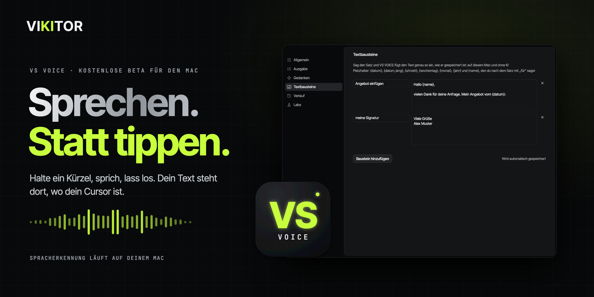
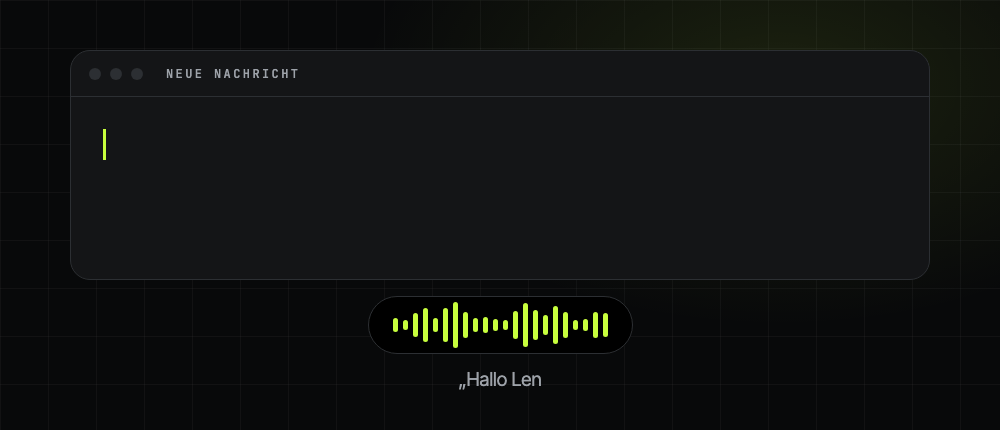
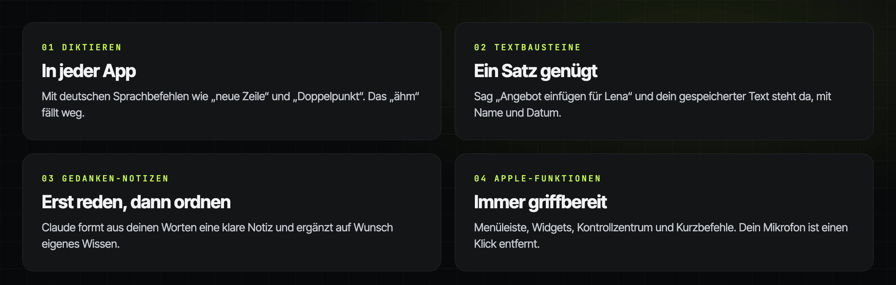
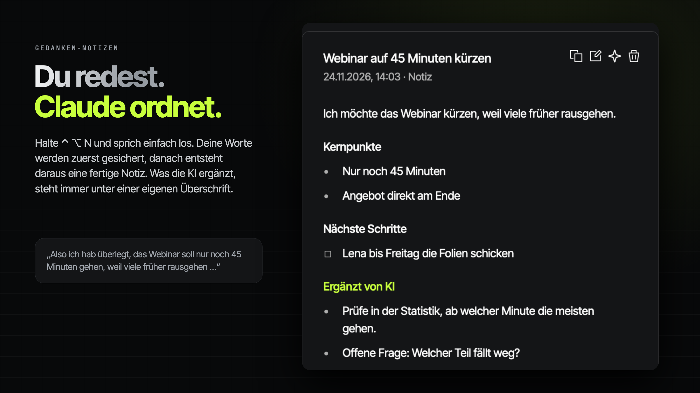
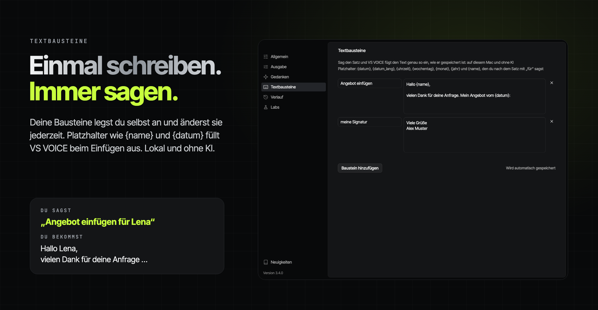
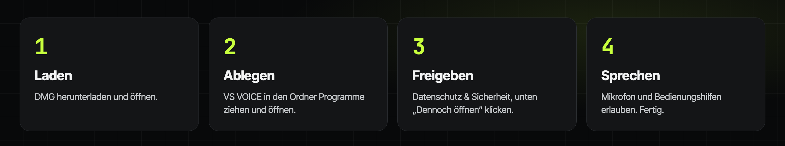

Kostenlose Beta · 35 MB · Mac mit Apple-Chip (M1 oder neuer) · ab macOS 15

# VS VOICE

Mit VS VOICE sprichst du deine Texte einfach ein, in jeder App auf deinem Mac. Du hältst ein Kürzel, sprichst, lässt los, und dein Text steht dort, wo dein Cursor ist. Die Spracherkennung läuft dabei auf deinem eigenen Mac.

## Was VS VOICE für dich macht

### Gedanken-Notizen

Für die Notizen brauchst du einen eigenen Anthropic-API-Schlüssel oder Claude Code. Ohne beides bleiben deine Worte als Notiz gespeichert.

### Textbausteine

### Auf deinem Mac zu Hause

Du startest Diktat und Gedanken über die Menüleiste oder Kurzbefehle. Ab macOS 26 kommen Widgets und das Kontrollzentrum dazu.

## Installieren

1. DMG öffnen und VS VOICE in den Ordner **Programme** ziehen.
2. VS VOICE öffnen. Die App ist nicht von Apple geprüft, deshalb warnt macOS: Klick auf **Fertig**.
3. **Systemeinstellungen › Datenschutz & Sicherheit** öffnen, unten bei VS VOICE auf **Dennoch öffnen** klicken und bestätigen.
4. Der Einführung folgen und **Mikrofon** und **Bedienungshilfen** erlauben.

Prüfsumme (SHA-256) von Version 3.4.0

`10f7d5841726d32ff6a3554eba465b46fbfefb19e08dc7a72360bc67416ae795`

## Deine Daten

| | Wo es passiert |
|---|---|
| Aufnahme und Spracherkennung | auf deinem Mac |
| Textbausteine | auf deinem Mac, ohne KI |
| Gedanken-Notizen | der erkannte Text geht an Anthropic, über deinen eigenen Zugang. Die Aufnahme bleibt auf deinem Mac. |

## Von VIKITOR

<a href="https://vikitor.de"><b>vikitor.de</b></a> · <a href="https://vikitor.de/downloads/">Weitere kostenlose Werkzeuge</a> · <a href="https://vikitor.de/live/">Live dabei sein</a>

---

VS VOICE baut auf [Hex](https://github.com/anomalyco/hex) auf (MIT), siehe [LICENSE](LICENSE) und [THIRD_PARTY_NOTICES.md](THIRD_PARTY_NOTICES.md).
